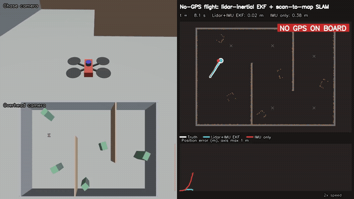
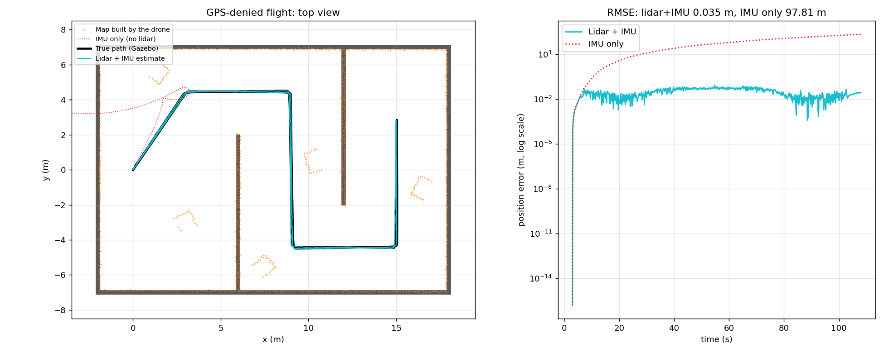

# 01: GPS-denied lidar-inertial navigation



A quadrotor with **no GNSS receiver** flies a 66 m route through a two-room building in Gazebo.
It localizes with an IMU, a 2D lidar and a downward rangefinder, builds a map as it goes, and the
waypoint controller is steered **only by that estimate**. Gazebo ground truth is logged for scoring
and never reaches the navigation code.

[Full video (mp4)](media/lidar_inertial_flight.mp4)

## Result (one flight, 101 s, 66.3 m)

| Metric | Lidar + IMU EKF | IMU only (same data) |
|---|---|---|
| Horizontal RMSE | **0.035 m** | 97.8 m |
| Max error | 0.085 m | |
| Error after landing back at start | 0.027 m | 215.6 m |
| Yaw RMSE | 0.18 deg | |
| Waypoints reached | 10 / 10, landed | |
| Lidar scans fused / rejected | 1022 / 0 | |



## How it works

| Part | Method |
|---|---|
| Attitude | Gyro integration with a slow accelerometer correction (tau = 15 s). On a multirotor the accelerometer barely observes tilt in flight, so it only removes slow drift. |
| Filter | 6-state EKF: position, velocity, yaw, gyro-z bias. Prediction from body accelerations rotated into the level frame. |
| Lidar | Each scan is tilt-compensated, then aligned to the map with point-to-point ICP (SVD solution, shrinking correspondence gate). The result is fused as a pose measurement. |
| Map | Starts once airborne; new points are added only where the map is empty (keyframes every 0.5 m). |
| Altitude | Downward lidar rangefinder, tilt-corrected. |
| Guidance | Proportional velocity commands toward waypoints, sent to Gazebo's multicopter velocity controller. |

Scans are rejected if fewer than 55% of points match, the residual exceeds 0.15 m, or the jump from
the prediction is too large.

## Run

```bash
source /opt/ros/lyrical/setup.bash
bash run.sh              # Gazebo window, recording and video
HEADLESS=1 bash run.sh   # no window
```

Outputs go to `results/` (log, map, metrics, plot) and `media/` (video, GIF).

## Limitations

- One flight, so this shows the method works rather than measuring its error distribution.
- The world is static, flat-floored and feature-rich, with no loop closure. A long corridor or
  moving people would be harder.
- The inner velocity loop is Gazebo's multicopter controller, which uses the simulator's true
  velocity. Navigation (position and yaw) is fully estimate-driven.
- The IMU-only number is a baseline using the same simple attitude filter, not a tuned INS.
