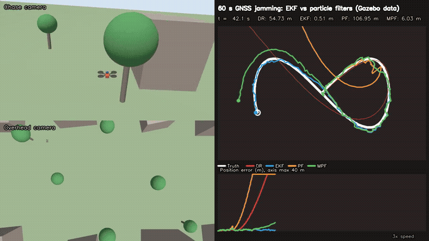
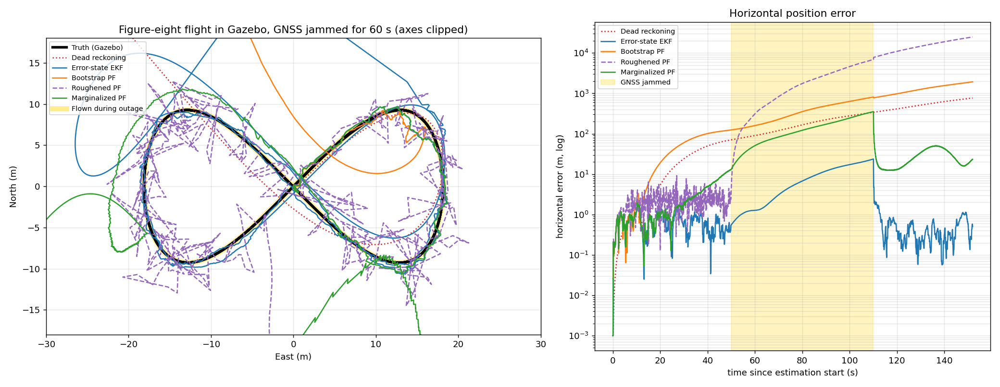

# 02: Error-state EKF vs particle filters on Gazebo flight data



My GNSS-denied navigation benchmark compares a 15-state error-state EKF with bootstrap,
roughened and marginalized particle filters on a synthetic trajectory. This project tests the same
estimators on **data from a physically simulated quadrotor**: a figure-eight flight in Gazebo with a
200 Hz MEMS-grade IMU and a 5 Hz GNSS receiver, replayed with a **60 s GNSS outage**.

[Full video (mp4)](media/eskf_vs_pf_flight.mp4)

## Pipeline

1. `fly_and_record.py` flies a 36 x 18 m figure eight at 6 m and records raw IMU, GNSS (latitude and
   longitude converted to local ENU) and ground truth. The pilot uses ground truth, like a survey
   pilot; the estimators are not in the loop.
2. `replay_filters.py` feeds the recording, packet by packet, through the estimators' `step()`
   interface. GNSS is withheld from 50 to 110 s. Particle filters run with 1000 particles and five
   random seeds each.
3. `plot_results.py` and `common/compose_video.py` produce the plot and video.

The estimator code in `estimators/gps_denied_navigation` is copied unchanged from the benchmark
package. The filter noise models use the same values as the simulated sensors.

## Result (one flight, 152 s; particle filters: median over 5 seeds, range in brackets)

| Estimator | RMSE with GNSS (m) | RMSE in 60 s outage (m) | Error at outage end (m) | Recovery after GNSS returns (s) | Time per epoch (us) |
|---|---|---|---|---|---|
| Dead reckoning (never uses GNSS) | 32.79 | 197.22 | 337.83 | n/a | 330 |
| **Error-state EKF** | **0.75** | **11.08** | **23.51** | **0.4** | 1263 |
| Bootstrap PF | 59.98 (19.04-92.11) | 438.51 (117.65-678.73) | 809.97 (202.39-1205.91) | none | 1084 |
| Roughened PF | 2.57 (2.52-2.76) | 5705 (2993-15103) | 12707 (6849-33603) | none | 1450 |
| Marginalized PF | 3.62 (1.19-4.23) | 167.87 (45.25-187.66) | 345.07 (98.50-380.71) | 2.6 | 3868 |

GNSS sanity check against truth: mean offset (-0.01, -0.14, -0.03) m, standard deviation about 1.5 m per axis.



## What the data says

- **The EKF is the only estimator that is usable through the outage**: 11 m RMSE over 60 s of pure
  inertial navigation, recovering within 0.4 s once GNSS returns. Its bias states, learned while GNSS
  was available, slow the drift.
- **The bootstrap PF fails even while GNSS is available.** This reproduces the benchmark's earlier
  finding on synthetic data: tilt and bias states get almost no diffusion, so the cloud collapses to
  one ancestor and then tracks confidently but wrongly. Here it happens on physically simulated
  sensor data too.
- **Roughening is not enough.** It keeps the cloud alive while GNSS is present (2.6 m RMSE), but the
  injected attitude and bias noise integrates into kilometre-scale drift once measurements stop.
- **Marginalizing the linear states helps a lot but not enough**: about 15 times smaller outage
  error than roughening, yet still about 15 times worse than the EKF, at 3 times the compute.

## Run

```bash
source /opt/ros/lyrical/setup.bash
bash run.sh                  # fly, record, replay, plot, video
REPLAY_ONLY=1 bash run.sh    # reuse results/*.csv
```

## Limitations

- One flight and one outage window; the particle filter seeds vary only the filter's randomness.
- Estimators are initialized from truth while hovering, as the benchmark's `initialize_from_truth`
  option does.
- IMU biases are constant per run (Gazebo draws them at start-up); real MEMS biases also wander.
- GNSS noise is white and Gaussian, with no multipath or correlated error.
