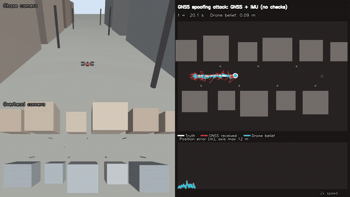
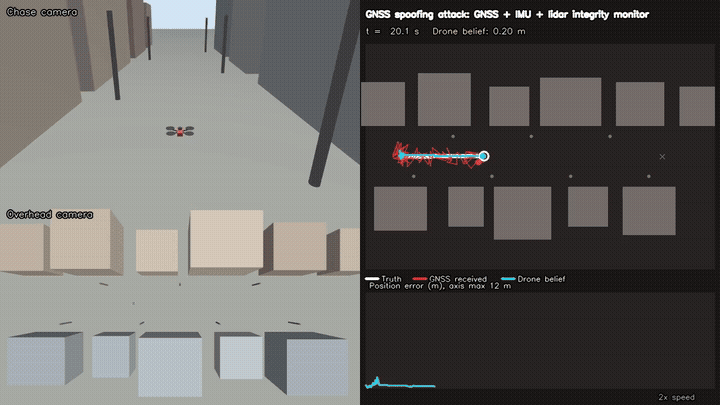
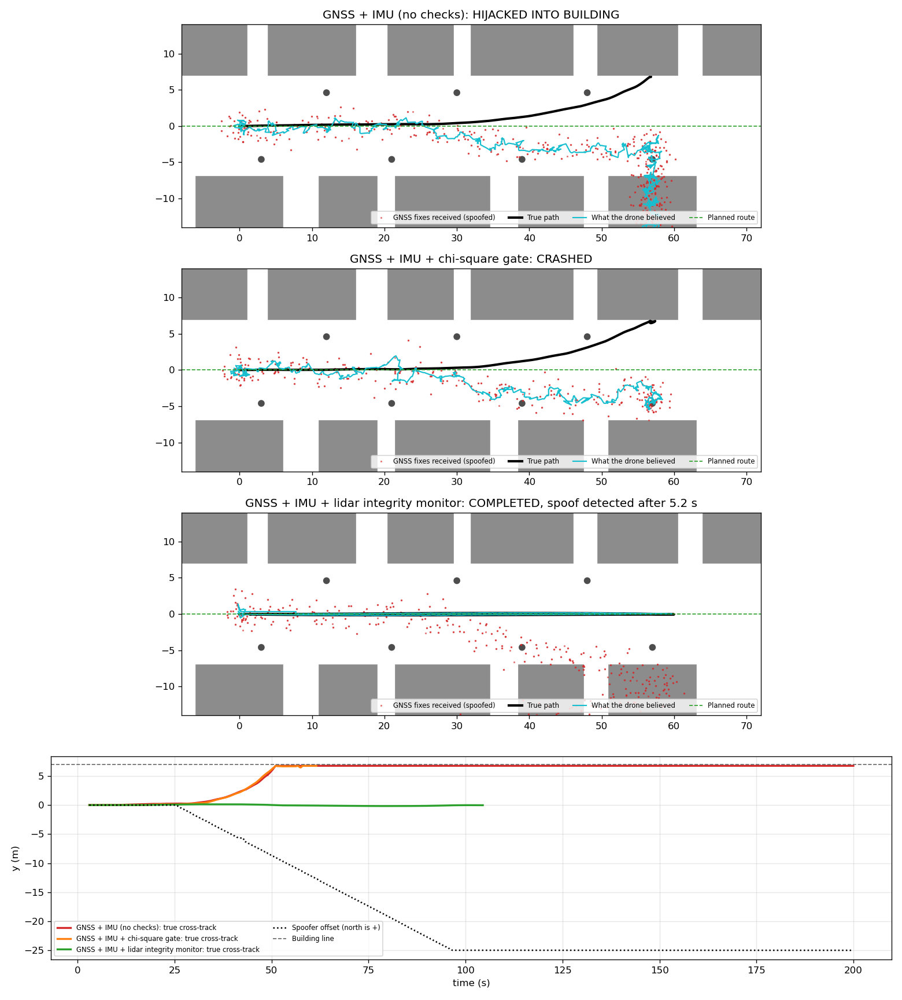

# 03: GNSS spoofing attack and lidar-aided integrity monitoring

| No checks: hijacked into a building | Lidar integrity monitor: attack detected, mission completed |
|---|---|
|  |  |

A delivery quadrotor flies 60 m down a street and back, **navigating on its own estimate**. At t = 25 s
a spoofer starts a slow *carry-off* attack: the received GNSS position is dragged south at 0.35 m/s
(up to 25 m). The autopilot "corrects" for the fake error and steers the real drone north, into the
buildings. The same airframe, route and attack are flown three times with different navigation.

Videos: [no checks](media/spoofing_naive.mp4) · [chi-square gate](media/spoofing_gated.mp4) · [lidar monitor](media/spoofing_lidar.mp4)

## Result

| Navigation | Outcome | Spoof detected after | Max true cross-track (m) | Min clearance to obstacles (m) | Max navigation error (m) |
|---|---|---|---|---|---|
| GNSS + IMU (no checks) | **Hijacked into building** | never | 6.77 | 0.23 | 26.63 |
| GNSS + IMU + chi-square gate (99%) | **Crashed** at t = 57.6 s | never | 6.76 | 0.24 | 11.47 |
| GNSS + IMU + lidar integrity monitor | **Completed** | **5.2 s** | 0.17 | 4.25 | 1.54 |



## Why the standard gate fails

A per-fix chi-square innovation gate compares each fix with the filter's prediction. A carry-off
attack moves only 0.07 m between 5 Hz fixes, far below the 1.2 m GNSS noise, so every fix passes and
the filter follows the attacker. The gated drone fused 290 spoofed fixes and flew into a wall
without a single rejection.

## The defence

1. **Lidar-inertial EKF.** The drone localizes against a lidar map it builds itself (scan-to-map ICP,
   as in project 01), which is independent of GNSS.
2. **Map alignment.** After takeoff, 40 fixes (8 s) are averaged against the lidar position to shift
   the map into the GNSS frame once. GNSS is assumed honest during this takeoff window.
3. **Windowed integrity test.** With lidar holding the estimate tight, the GNSS normalized innovation
   squared (NIS) is averaged over the last 25 fixes (5 s). Under honest GNSS the sum is chi-square with
   50 degrees of freedom; above its 99.9% point, GNSS is declared spoofed and **isolated** for the
   rest of the flight.
4. The mission continues on lidar + IMU alone.

The alarm fired when the fake offset was about 1.8 m, about 1.5 times the GNSS noise.

## Run

```bash
source /opt/ros/lyrical/setup.bash
bash run.sh                    # three flights with the Gazebo window, plot, three videos
MODES="lidar" bash run.sh      # one scenario
```

`spoofer.py` sits between the receiver and navigation (`/navsat` to `/navsat/received`). Attack
start, rate, direction and cap are constants at the top of the file.

## Limitations

- One flight per scenario. Detection delay and false-alarm rate need Monte Carlo runs and attack
  sweeps to be properly characterized.
- The lidar estimate drifted about 1.5 m along the street on the return leg: flat facades constrain
  cross-track position well but along-track position poorly, and there is no loop closure.
  Cross-track error, which decides collisions, stayed under 0.2 m.
- An attacker who starts before takeoff alignment, or spoofs slower than the test can see over its
  5 s window, is outside this design.
- The inner velocity loop is Gazebo's multicopter controller, which uses true velocity.
- Crash detection uses ground truth (tilt above 1 rad, or altitude below 0.8 m in flight); it only
  labels the outcome.
