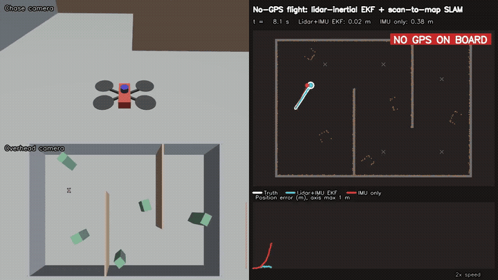
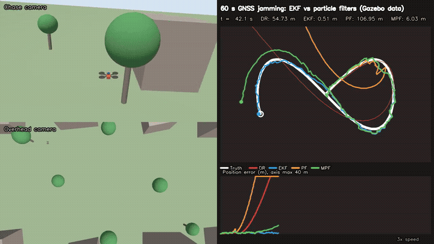
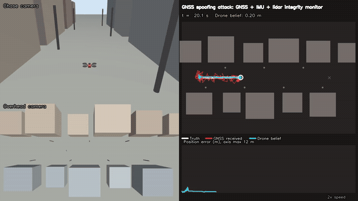

# UAV autonomy in ROS 2 and Gazebo

Three quadrotor navigation studies in **ROS 2 (Lyrical)** and **Gazebo (gz-sim 10)**, built around
one question: *what does a drone do when GNSS is missing, jammed or lying?* Every result below comes
from closed-loop or recorded Gazebo flights, scored against simulator ground truth that the
navigation code never sees.

| | Project | Headline |
|---|---|---|
|  | [**01: GPS-denied lidar-inertial navigation**](01_lidar_inertial_nav) | No GNSS on board. EKF + scan-to-map lidar SLAM flies a 66 m indoor route at **3.5 cm RMSE**; IMU alone drifts 98 m. |
|  | [**02: Error-state EKF vs particle filters on Gazebo data**](02_eskf_vs_pf_gazebo) | 60 s GNSS outage on a 200 Hz IMU recording. EKF: **11 m** RMSE. Bootstrap, roughened and marginalized PFs: 168 m to 5.7 km. |
|  | [**03: GNSS spoofing attack and defence**](03_gps_spoofing_defense) | A slow carry-off attack steers GNSS-only drones into a building, even with a chi-square gate. Lidar integrity monitoring detects it in **5.2 s** and completes the mission. |

## Results at a glance

| Project | Scenario | Key numbers |
|---|---|---|
| 01 | Indoor, no GNSS, 101 s flight | Position RMSE 0.035 m, max 0.085 m, 10/10 waypoints, 0 lidar scans rejected |
| 02 | Outdoor figure eight, GNSS jammed 50 to 110 s | EKF outage RMSE 11.1 m, recovers in 0.4 s; best PF (marginalized) 167.9 m |
| 03 | Street delivery, GNSS spoofed from 25 s | No checks: hijacked. Chi-square gate: crashed. Lidar monitor: detected in 5.2 s, 0.17 m max cross-track |

## Repository layout

```
common/                  shared pieces
  make_world.py          quadrotor and world generator (sensors, cameras, scenery)
  nav_core.py            planar EKF, scan-to-map ICP, attitude filter, GNSS conversions
  launch_sim.sh          Gazebo server + window, ROS-Gazebo bridge, camera recorder
  frame_recorder.py      saves camera frames for the videos
  compose_video.py       video: chase camera, overhead camera, live map and error traces
01_lidar_inertial_nav/   GPS-denied flight with lidar SLAM
02_eskf_vs_pf_gazebo/    recorded flight replayed through EKF and particle filters
03_gps_spoofing_defense/ spoofing attack, three navigation variants
```

Each project folder has a `run.sh` that flies the scenario, scores it and renders its video, plus
a README with method, results and limitations.

## Setup

Tested on Ubuntu 26.04 under WSL2 with ROS 2 Lyrical and Gazebo 10.5.

```bash
sudo apt install ros-lyrical-desktop ros-lyrical-ros-gz ffmpeg python3-opencv python3-matplotlib
source /opt/ros/lyrical/setup.bash
cd 01_lidar_inertial_nav && bash run.sh
```

The quadrotor uses the rotor, inertia and controller parameters of Gazebo's X3 example
(`multicopter_velocity_control.sdf`). Sensors: IMU with bias and white noise, 2D lidar, downward
rangefinder and NavSat GNSS, as each project needs.

## Notes

- Each result is a single flight (project 02 also repeats each particle filter with 5 seeds). The
  numbers show behaviour, not error distributions; Monte Carlo runs are the natural next step.
- Gazebo's multicopter velocity controller closes the inner loop on true velocity. Position, yaw
  and mission logic run on the estimators.

## License

MIT
